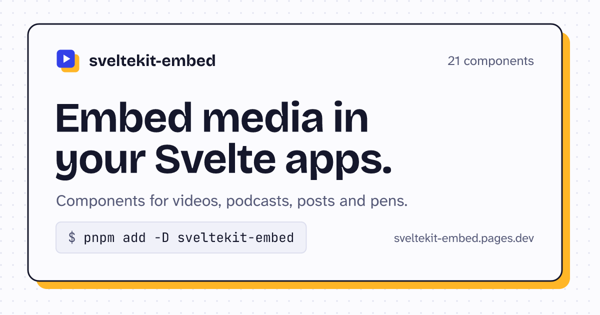

# SvelteKit Embed

<!-- ALL-CONTRIBUTORS-BADGE:START - Do not remove or modify this section -->

[](#contributors-)

<!-- ALL-CONTRIBUTORS-BADGE:END -->

[](https://madewithsvelte.com/p/sveltekit-embed/shield-link)

[](https://github.com/spences10/sveltekit-embed/actions/workflows/unit-test.yml)

Embed media in your Svelte apps.

A collection of embed components I use on a regular basis, packaged up
for use: videos, podcasts, social posts and code. They work in Svelte
files and in Markdown with mdsvex.

**Docs and live examples: <https://sveltekit-embed.pages.dev>**

[](https://sveltekit-embed.pages.dev)

## Use it

Add the package to a SvelteKit project. It needs Svelte 5.29 or later.

```bash
pnpm add -D sveltekit-embed
```

Import the component you need and give it an ID or a link:

```svelte
<script>
	import { YouTube } from 'sveltekit-embed';
</script>

<YouTube youtube_id="dQw4w9WgXcQ" />
```

It works the same way in Markdown with mdsvex:

```markdown
<script>
	import { YouTube } from 'sveltekit-embed';
</script>

# My post

<YouTube youtube_id="dQw4w9WgXcQ" />
```

## Components

Each one has a page on the docs site with a live example, usage and a
table of its props.

**Video**

- [TikTok](https://sveltekit-embed.pages.dev/components/tiktok)
- [Vimeo](https://sveltekit-embed.pages.dev/components/vimeo)
- [YouTube](https://sveltekit-embed.pages.dev/components/youtube)

**Audio and podcasts**

- [AnchorFm](https://sveltekit-embed.pages.dev/components/anchorfm)
- [Buzzsprout](https://sveltekit-embed.pages.dev/components/buzzsprout)
- [Deezer](https://sveltekit-embed.pages.dev/components/deezer)
- [SimpleCast](https://sveltekit-embed.pages.dev/components/simplecast)
- [SoundCloud](https://sveltekit-embed.pages.dev/components/soundcloud)
- [Spotify](https://sveltekit-embed.pages.dev/components/spotify)
- [Zencastr](https://sveltekit-embed.pages.dev/components/zencastr)

**Social posts**

- [Bluesky](https://sveltekit-embed.pages.dev/components/bluesky)
- [Threads](https://sveltekit-embed.pages.dev/components/threads)
- [Toot](https://sveltekit-embed.pages.dev/components/toot)
- [Tweet](https://sveltekit-embed.pages.dev/components/tweet)

**Code**

- [CodePen](https://sveltekit-embed.pages.dev/components/codepen)
- [Gist](https://sveltekit-embed.pages.dev/components/gist)
- [StackBlitz](https://sveltekit-embed.pages.dev/components/stackblitz)

**Everything else**

- [GenericEmbed](https://sveltekit-embed.pages.dev/components/genericembed),
  an iframe for anything without its own component yet
- [Guild](https://sveltekit-embed.pages.dev/components/guild)
- [Relive](https://sveltekit-embed.pages.dev/components/relive)
- [Slides](https://sveltekit-embed.pages.dev/components/slides)

## Lazy loading

Every iframe embed sets `loading="lazy"`, so the browser only loads it
when it is close to the viewport. Pass `loading="eager"` to load one
straight away.

The package also exports `in_view`, an attachment for lazy loading
your own markup. See
[how lazy loading works](https://sveltekit-embed.pages.dev/lazy-loading).

## Got questions?

[Start a discussion](https://github.com/spences10/sveltekit-embed/discussions/new)

## Something not work?

Create an
[issue](https://github.com/spences10/sveltekit-embed/issues/new)

## Developing locally

For the `web` app and testing new components there you'll need to have
empty `env` variables. Rename the `.sample.env` file to `.env`.

```bash
mv .sample.env apps/web/.env
```

Start the docs site, which packages the library first:

```bash
pnpm install
pnpm run dev:web
```

### Adding a component

Create the component in the
`packages/sveltekit-embed/src/lib/components` directory.

Export the component from the
`packages/sveltekit-embed/src/lib/index.ts` file:

```ts
export { default as MyComponent } from './components/my-component.svelte';
```

Then document it in the `web` app. The docs tests fail until all three
of these are done, so a component can't ship without them.

1. Add an entry to `apps/web/src/lib/docs/components.ts` with its
   name, category, description, search keywords and props. The home
   page, the command palette and the props table are built from this.

2. Add its page at
   `apps/web/src/lib/content/components/mycomponent.md`, named as the
   component in lower case. A fence marked `live` renders the embed
   and shows its source:

   ````markdown
   <script>
   	import { MyComponent } from 'sveltekit-embed';
   </script>

   ```svelte live
   <MyComponent my_component_id="..." />
   ```

   Anything a reader needs to know to find the ID goes here.
   ````

3. Render its share image:

   ```bash
   pnpm --filter=web run share-cards
   ```

Run the checks, then submit a PR 🙏

```bash
pnpm run check
pnpm run test:ci
```

## Thanks

Credit to [@pauliescanlon](https://github.com/pauliescanlon) for the
original version of this project in
[MDX Embed](https://github.com/pauliescanlon/mdx-embed).

## Packaging for NPM

Scott, this is here for you to remember how to do this 🙃

Although I detailed this in
[Making npm Packages with SvelteKit](https://scottspence.com/posts/making-npm-packages-with-sveltekit)
I think it's best to put it here as I always come to the README and
the instructions are never there! 😅

**Publish the project to NPM**

```bash
# authenticate with npm
npm login
# bump version with npm
npm version 0.0.8
# package with sveltekit
pnpm run package
# publish
npm publish
# push tags to github
git push --tags
```

**Publish @next package**

Same procedure except use the `--tag` flag:

```bash
# authenticate with npm
npm login
# bump version with npm
npm version 0.0.13
# package with sveltekit
pnpm run package
# publish with tag
npm publish --tag next
# push tags to github
git push --tags
```

**Move @next package to latest**

```bash
# authenticate with npm
npm login
# move @next to latest
npm dist-tag add sveltekit-embed@0.0.13 latest
```

## Contributors ✨

Thanks goes to these wonderful people

<!-- ALL-CONTRIBUTORS-LIST:START - Do not remove or modify this section -->
<!-- prettier-ignore-start -->
<!-- markdownlint-disable -->
<table>
  <tbody>
    <tr>
      <td align="center" valign="top" width="14.28%"><a href="https://scottspence.com/"><br /><sub><b>Scott Spence</b></sub></a><br /><a href="https://github.com/spences10/sveltekit-embed/commits?author=spences10" title="Code">💻</a></td>
      <td align="center" valign="top" width="14.28%"><a href="https://github.com/Cahllagerfeld"><br /><sub><b>Cahllagerfeld</b></sub></a><br /><a href="https://github.com/spences10/sveltekit-embed/commits?author=Cahllagerfeld" title="Code">💻</a></td>
      <td align="center" valign="top" width="14.28%"><a href="https://matiashernandez.dev/"><br /><sub><b>Matías Hernández Arellano</b></sub></a><br /><a href="https://github.com/spences10/sveltekit-embed/commits?author=matiasfha" title="Code">💻</a></td>
      <td align="center" valign="top" width="14.28%"><a href="https://ruhr.social/@sphinxc0re"><br /><sub><b>Julian Laubstein</b></sub></a><br /><a href="https://github.com/spences10/sveltekit-embed/commits?author=sphinxc0re" title="Code">💻</a></td>
      <td align="center" valign="top" width="14.28%"><a href="https://github.com/Ennoriel"><br /><sub><b>Maxime Dupont</b></sub></a><br /><a href="https://github.com/spences10/sveltekit-embed/commits?author=Ennoriel" title="Code">💻</a></td>
      <td align="center" valign="top" width="14.28%"><a href="https://jamesperkins.dev/"><br /><sub><b>James Perkins</b></sub></a><br /><a href="https://github.com/spences10/sveltekit-embed/commits?author=perkinsjr" title="Code">💻</a></td>
      <td align="center" valign="top" width="14.28%"><a href="https://joaopalmeiro.github.io/"><br /><sub><b>João Palmeiro</b></sub></a><br /><a href="https://github.com/spences10/sveltekit-embed/commits?author=joaopalmeiro" title="Code">💻</a></td>
    </tr>
    <tr>
      <td align="center" valign="top" width="14.28%"><a href="https://github.com/Jason3S"><br /><sub><b>Jason Dent</b></sub></a><br /><a href="https://github.com/spences10/sveltekit-embed/commits?author=Jason3S" title="Code">💻</a></td>
    </tr>
  </tbody>
  <tfoot>
    <tr>
      <td align="center" size="13px" colspan="7">
        
          <a href="https://all-contributors.js.org/docs/en/bot/usage">Add your contributions</a>
        </img>
      </td>
    </tr>
  </tfoot>
</table>

<!-- markdownlint-restore -->
<!-- prettier-ignore-end -->

<!-- ALL-CONTRIBUTORS-LIST:END -->

([emoji key](https://allcontributors.org/docs/en/emoji-key)):

This project follows the
[all-contributors](https://github.com/all-contributors/all-contributors)
specification. Contributions of any kind welcome!
